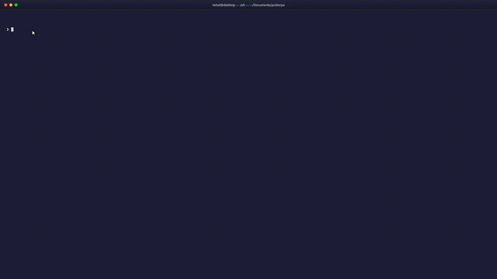

# prsherpa

`prsherpa` checks a git branch **before** you open a pull request. It prints a reviewability score (0–100), flags common reviewability issues, suggests a reading order for the reviewer, and estimates review time.

It is offline, deterministic, and calls the `git` CLI directly.



## Install

```bash
cargo install --path .
```

Or build from source:

```bash
cargo build --release
```

## Usage

Run inside a git repository on your feature branch:

```bash
prsherpa
```

### Options

```text
prsherpa [--base <branch>] [--format <terminal|json|markdown>] [--fail-under <N>] [--config <path>]
```

- `--base <branch>`: Base branch to compare against (defaults to `origin/main`, `origin/master`, `main`, or `master`).
- `--format <terminal|json|markdown>`: Output format (`terminal` by default; `--json` is kept as a hidden alias).
- `--fail-under <N>`: Exit with code `1` if the score is below `N` (0–100).
- `--config <path>`: Path to a `.prsherpa.toml` config file (defaults to `.prsherpa.toml` at the repo root if present).

### Exit codes

- `0`: Success
- `1`: Score is below `--fail-under`
- `2`: Operational error (not a git repo, no changes, base branch not found, invalid config)

## Configuration (`.prsherpa.toml`)

Place an optional `.prsherpa.toml` in your repository root:

```toml
base_branch = "main"
size_warn = 400
size_strong_warn = 800
max_files = 15
max_dirs = 5
risky_keywords = ["auth", "login", "session", "payment", "billing", "migration", "security", "secret", ".env", "permission"]
ignore_patterns = ["*.snap", "vendor/*"]
```

## GitHub Actions Example (`.github/workflows/prsherpa.yml`)

```yaml
name: prsherpa

on:
  pull_request:

jobs:
  reviewability:
    runs-on: ubuntu-latest
    steps:
      - uses: actions/checkout@v4
        with:
          fetch-depth: 0
      - uses: dtolnay/rust-toolchain@stable
      - run: cargo install --path .
      - run: prsherpa --base "origin/${{ github.base_ref }}" --format markdown --fail-under 60 > prsherpa-report.md
      - uses: actions/github-script@v7
        if: always()
        with:
          script: |
            const fs = require('fs');
            if (!fs.existsSync('prsherpa-report.md')) return;
            const body = fs.readFileSync('prsherpa-report.md', 'utf8');
            await github.rest.issues.createComment({
              owner: context.repo.owner,
              repo: context.repo.repo,
              issue_number: context.issue.number,
              body
            });
```
